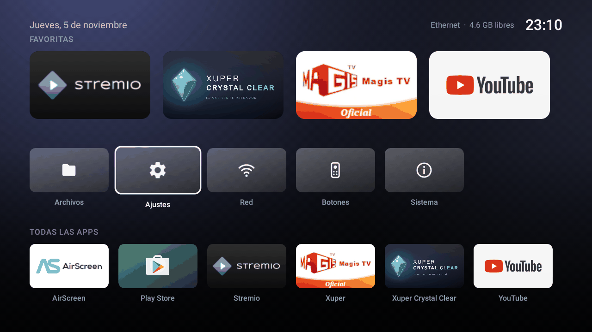
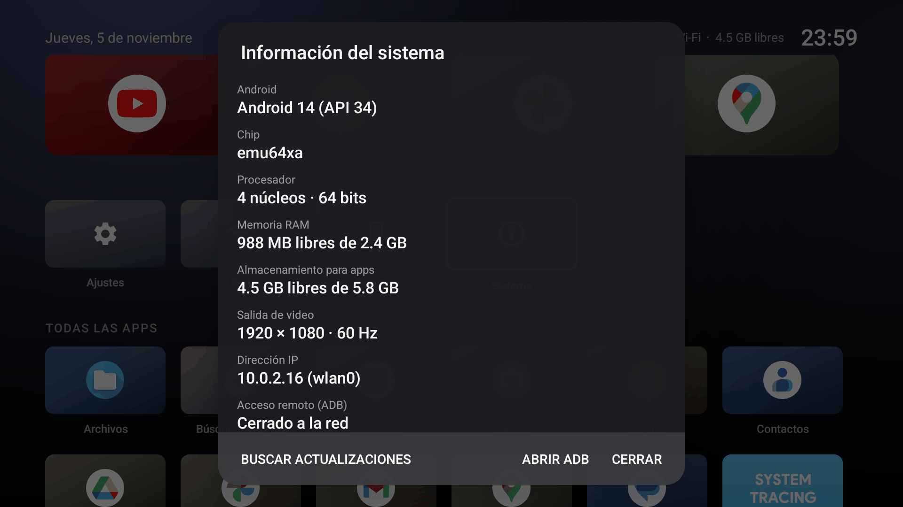
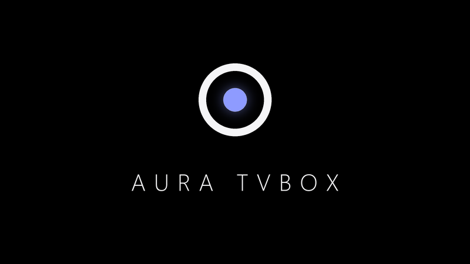

# Aura TV Box Launcher · v1.2

Convierte una TV Box Android genérica en un equipo limpio, honesto y minimalista:

- **Aura**: launcher estilo Apple TV (inspirado en [Lumen](https://github.com/jacksonjao/lumen)) para control remoto.
- **Scripts** para detectar firmware que miente (versión, RAM, almacenamiento), ADB falso, malware preinstalado,
  proxys y puertas traseras; respaldar; limpiar; y dejar tu configuración como "de fábrica" (sobrevive a un formateo).

## Probado en
| Caja (chip real) | Lo que decía | Lo que era en realidad | Qué traía | Historial |
|---|---|---|---|---|
| HiSilicon Hi3798MV300H | Android 11.1, 4 GB de RAM, 32 GB | **Android 9**, 1 GB, 3,2 GB para apps | Proxy residencial, puerta trasera root e instaladores ocultos | `docs/01`–`03` |
| Rockchip RK3228A | Android 11.1, 4 GB de RAM, 32 GB | **Android 7.1**, 1 GB, 5,4 GB para apps | Proxy residencial, servicio root en la red e instaladores | `docs/04` |



*Capturas de Aura en un emulador de TV, con apps de ejemplo.*

| Sistema: datos reales del equipo | Logo de arranque |
|---|---|
|  |  |

---

## Sólo quiero el launcher

No hace falta limpiar tu TV Box: Aura se instala como cualquier app (Android 5.0 o superior, cualquier procesador).

**⬇️ [Descargar Aura.apk](https://github.com/jorgejbz/Aura-TVBox-Launcher/releases/latest/download/Aura.apk)**
· todas las versiones en [Releases](https://github.com/jorgejbz/Aura-TVBox-Launcher/releases)

Elige una forma de instalarlo:
- **Con una memoria USB** (sin PC conectada): copia el APK a la memoria, conéctala a la TV Box, ábrelo con el
  explorador de archivos de la caja y pulsa *Instalar*. Si pide permiso de "fuentes desconocidas", actívalo
  sólo para ese explorador.
- **Desde la propia TV**: instala una app para descargar archivos (por ejemplo *Downloader* de Play Store),
  escribe el enlace de descarga de arriba e instala.
- **Por ADB desde la PC**: `adb install -r Aura.apk`.

Después:
1. Pulsa **Inicio** en el control y elige **Aura → Siempre**. En Android 10 o superior también puedes hacerlo en
   *Ajustes › Apps › Apps predeterminadas › App de inicio*. Tu launcher anterior no se borra: puedes volver a él ahí mismo.
2. Para usar los botones del control con tus apps, abre Aura › **Botones** › *Activar el servicio* y enciende
   **"Botones del control (Aura)"** en *Ajustes › Accesibilidad*. Sólo recibe pulsaciones de teclas; no lee la pantalla.
3. Mantén **OK** (o pulsa **Menú**) sobre una app para añadirla a Favoritas, moverla o ver su información.

> Si tu caja muestra datos raros (dice tener más RAM o una versión de Android que no cuadra), la tarjeta
> **Sistema** de Aura te enseña los datos reales. Si quieres ir más allá y quitar malware de fábrica, sigue la
> guía de abajo.

## ¿Usas Claude Code?
Copia el contenido de **[PROMPT-CLAUDE-CODE.txt](PROMPT-CLAUDE-CODE.txt)**, completa los datos de tu caja y pégalo en
Claude Code: seguirá esta guía paso a paso, pidiéndote permiso antes de cada cambio importante.

## La forma rápida: `Preparar-TVBox.bat`
Con la PC preparada (paso 0 de abajo) y la caja conectada por cable con la depuración activada (paso 1), haz doble clic
en **`Preparar-TVBox.bat`** y escribe la IP de la caja. Recorre la guía entera por etapas: diagnóstico, respaldo
verificado, limpieza, falsificaciones, `fabrica.ps1`, formateo y verificación final (incluida una prueba de YouTube con
audio 5.1 y estéreo).
- **Firmware conocido** (los de `scripts/perfiles/`): automático de principio a fin, sin preguntar. Sólo actúa si el
  firmware coincide con el perfil y el respaldo se verificó partición por partición. Con `-Preguntar` pide confirmar
  antes de cada bloque que borra, escribe en `/system` o formatea.
- **Avisa con sonido y voz** al terminar, si se detiene o si el firmware es nuevo.
- **Claude Code como vigilante:** si está instalado, el `.bat` lo abre en otra ventana. Si el proceso se detiene, lee el
  registro, corrige el script y lo retoma (ver `CLAUDE.md`). Para no abrirlo: `set AURA_SIN_CLAUDE=1`.
- **Respaldos:** si la verificación final sale sin fallas, se borra el respaldo de esa caja (`-ConservarRespaldo` lo
  guarda). Si hay fallas, se conserva.
- **Firmware nuevo:** hace el diagnóstico y el respaldo, que no cambian nada, y se detiene. Sigue la guía a mano;
  lo aprendido se guarda luego como un perfil nuevo.
- **Cada caja tiene un ID** sacado de su hardware, por ejemplo `RK3228A-1a2b3c4d`. Todo queda en
  `logs\cajas\<ID>\`: registro completo, diagnóstico, verificación, ficha y estado. Si algo se detiene, al abrir de
  nuevo el `.bat` sigue desde esa etapa. `logs\cajas\indice.csv` lista todas las cajas.
- **En otra PC sin nada instalado:** basta el `.bat` suelto dentro de la carpeta de las apps de fábrica (la que tiene
  `fabrica-rk322x\`, por ejemplo en OneDrive). Baja este proyecto de GitHub a `%LOCALAPPDATA%\Aura-TVBox` y lo
  actualiza cada vez; instala solo lo que falte (adb y build-tools de Google, Java portátil, Python). No hace falta
  Android Studio. `set AURA_APKS=<carpeta>` usa otra carpeta de apps; `set AURA_SIN_ACTUALIZAR=1` no actualiza.
- `scripts\preparar.ps1 -Ip <IP> -Simular` muestra lo que haría sin cambiar nada, y `scripts\verificar.ps1` repite la
  verificación cuando quieras.

## Inicio rápido: una TV Box nueva

> Cada caja es distinta. **El diagnóstico decide qué pasos aplican**; no des por cierto lo que dice la caja.
> **La receta completa está en [docs/GUIA-NUEVA-TVBOX.md](docs/GUIA-NUEVA-TVBOX.md)**, con cada comando, el malware ya
> identificado, qué apps conservar y los problemas conocidos. Esto es el resumen.

### 0. Preparar la PC (una vez)
1. Instala **Android Studio** (trae `adb`, `aapt2`, `apksigner`, `zipalign`, `dexdump` y Java).
2. `JAVA_HOME` de usuario → `C:\Program Files\Android\Android Studio\jbr`.
3. `git clone https://github.com/jorgejbz/Aura-TVBox-Launcher`, y `pip install capstone pyelftools pillow`.
4. Pon en `build\Aura.apk` la [última versión](https://github.com/jorgejbz/Aura-TVBox-Launcher/releases/latest/download/Aura.apk)
   y en `apks\fabrica\` tus apps.

### 1. Conectar la caja
En la TV: *Ajustes › Preferencias › Información* → pulsa 7 veces **Compilación** → *Opciones de desarrollador* →
**Depuración USB**. Conéctala a la red de la PC **por Ethernet**: tras formatear vuelve sola a la red. No uses el hotspot
de tu celular: el malware puede gastar tus datos.

### 2. Diagnosticar (sólo lectura)
```powershell
.\scripts\diagnostico.ps1 -Ip <IP_DE_TU_TVBOX>     # sin -Ip busca en una sola red /24 y se salta las 172.x
```
Deja un informe en `logs/` y marca con ⚠️: ADB falso, versión/RAM/almacenamiento falsificados, apps instaladas en
silencio, apps con permisos de sistema, servicios root escuchando y apps con muchas conexiones (proxy).
**Haz también las revisiones a mano de la guía**: conexiones por proceso, contenido de los APK sospechosos, y lo que
muestra Ajustes frente al kernel. Sin alertas no significa limpia. Si no aparece ADB, ver la guía.

### 3. Respaldar (antes de tocar nada)
```powershell
.\scripts\respaldar.ps1 -Serial <IP_DE_TU_TVBOX>:<PUERTO>
```
Compara cada SHA-256 con la caja y guarda el respaldo fuera de GitHub. Necesita un firmware que permita `adb root`.

### 4. Quitar el malware
En este orden: instala Aura para tener siempre inicio, **deshabilita los instaladores** y el launcher del fabricante,
desinstala lo que bajaron, sustituye `preinstall.sh`, **reinicia y verifica**, y sólo entonces borra de `/system`.

### 5. Quitar las falsificaciones
`build.prop`, `patch_javacore.py` (lo que ven las apps) y `patch_settings.py` (lo que muestra Ajustes). Los parches abortan
sin escribir si el firmware es otro, y la guía explica cómo localizar la falsificación en ese caso.

### 6. Quitar apps del fabricante
Launchers, exploradores, actualizadores y apps de prueba. La guía tiene la lista de qué quitar y qué **no**: sin
`HiRMService` y `HiVideoPlayer` no hay video en HiSilicon.

### 7. Dejarlo "de fábrica"
Edita `scripts/aura-defaults.properties` (favoritas y botones), y luego:
```powershell
.\scripts\fabrica.ps1 -Serial <IP_DE_TU_TVBOX>:<PUERTO> -Apks apks\fabrica -Idioma es-MX -ZonaHoraria America/Mexico_City
```
Instala Aura como app de sistema, tus apps (**borra lo que hubiera en `/system/preinstall`**) y el logo de arranque. Se
detiene sin tocar nada si el firmware no tiene mecanismo de preinstalación. Según la caja, añade `-Overscan 100` (imagen
completa, probado en Rockchip), `-Bind <carpeta>` (Ajustes parcheado) y `-ParcheAudio` (YouTube fluido con audio 5.1 en
Rockchip).

### 8. Revisar imagen, video y control
Comprueba que la imagen ocupa toda la pantalla, que el video usa el decodificador de hardware y qué botones declara tu
control. La guía tiene los comandos, y el puente HDMI-CEC si quieres usar el control de la TV.

### 9. Formatear y verificar
Un formateo real es la prueba final: pide permiso y sigue la lista de comprobación de la guía.

### 10. Cerrar
- Cierra el ADB por red en Aura › **Sistema** › *Cerrar ADB* y compruébalo desde la PC. Apagar la Depuración USB no basta
  en todos los firmwares, y un formateo puede reabrirlo. Para volver a entrar, *Abrir ADB*, desde la TV.
- No uses "Actualización del sistema" ni "Local update" del fabricante: reinstala el firmware original.

**¿Ya tienes una caja lista y sólo quieres actualizar Aura?** No uses `fabrica.ps1`: ver "Actualizar Aura" en la guía.

---

## Aura
Launcher Android nativo: Java, sin dependencias, Android 5.0+, ~65 KB.
- Favoritas grandes, accesos (Archivos, Ajustes, Red, Botones, Sistema) y todas las apps sin repetidos.
- Fondo que toma el color de la app enfocada; foco siempre visible; navegación sólo con flechas, OK, Atrás e Inicio.
- **Botones**: asigna apps a botones del control (servicio de accesibilidad que sólo filtra teclas, no lee la pantalla).
- **Sistema**: datos reales leídos del kernel, no del framework (que algunos firmwares falsifican), y estado real del
  ADB por red con un botón para cerrarlo o abrirlo.
- **Actualizaciones**: *Buscar actualizaciones* en Sistema, y *Actualizaciones del sistema* en Ajustes cuando Aura es app
  de sistema. Sólo consulta GitHub cuando lo pides y no envía datos de tu caja. Acepta sólo un APK con la firma de Aura y
  versión mayor, y Android pide confirmar antes de instalar.
- **Apps nuevas**: una vez al día Aura revisa tu carpeta de apps en línea, que son los APK del release `apps` de este
  repositorio. Si subes un APK de una app que la caja no tiene, o una versión más nueva de una que ya tiene, avisa
  *Nuevas apps disponibles, ¿le gustaría instalarlas?* y las instala una por una con el instalador de Android. Sólo
  avisa una vez de cada APK; también se busca a mano en Sistema › *Buscar actualizaciones* › *Buscar apps nuevas*. Cada
  APK nuevo se descarga una vez para saber qué app es. No envía datos de la caja. Otra carpeta:
  `apps.release=dueño/repo/etiqueta` en `defaults.properties`, o `apps.release=off` para apagarlo. Sólo admite APK
  sueltos (no apps divididas como YouTube), y lo instalado así no vuelve tras un formateo: para eso, `fabrica.ps1`.
- Como app de sistema (`/system/priv-app`) recupera favoritas y botones desde `/system/etc/aura/defaults.properties`.

Compilar: `cd launcher; .\gradlew.bat assembleRelease`.

## Scripts
| Script | Para qué |
|---|---|
| `Preparar-TVBox.bat` + `preparar.ps1` | Todo el proceso por etapas, con perfiles por firmware (`scripts/perfiles/`), registro por caja y reanudación. |
| `verificar.ps1` | La lista de comprobación del paso 10 de la guía, con prueba de YouTube 5.1 y estéreo; deja un informe. |
| `diagnostico.ps1` + `diag-remoto.sh` | Encuentra la caja, ADB real vs falso, datos reales vs anunciados, malware/proxy/puertas traseras. |
| `respaldar.ps1` | Copia las particiones críticas con SHA-256. |
| `fabrica.ps1` + `preinstall.sh` | Aura como app de sistema, tus apps en `/system/preinstall` (incluye APK divididos), animación de arranque y ajustes. |
| `bootanimation.py` | Genera `bootanimation.zip`, la animación de arranque de Aura. |
| `patch_javacore.py` | Quita la falsificación de almacenamiento de `libjavacore.so` (verifica los bytes; aborta si el build es otro). |
| `patch_settings.py` | Quita los 4 GB / 32 GB falsos de `Settings` y `TvSettings` en firmwares Rockchip conocidos (ver `docs/04`). |
| `patch_audiopolicy.py` | Hace que el HDMI de Rockchip informe estéreo, para que YouTube no elija audio 5.1 y vaya a tirones (ver `docs/04`). |
| `control-tv.ps1` | Instala el puente HDMI-CEC para usar **el control de la TV** ([cec-bridge/README.md](cec-bridge/README.md)). Probado con Samsung UN50TU7000 + control BN59-01259B. |
| `capturar.ps1`, `ui-estado.ps1` | Capturas y estado de pantalla para pruebas. |

## Carpeta local (no se sube a GitHub)
| Carpeta | Contenido |
|---|---|
| `llave-firma/` | **Llave de firma de Aura.** Sólo el dueño puede firmar actualizaciones que se instalen encima. Haz copia. |
| `apks/fabrica/` | Copia exacta de las apps usadas (para la siguiente caja). |
| `build/` | `Aura.apk` firmado. |
| `logs/` | Informes de diagnóstico (contienen IP/MAC de tu red). |

## Licencia y actualizaciones
Código bajo **[licencia MIT](LICENSE)**: puedes usarlo, modificarlo y redistribuirlo libremente conservando el aviso
de copyright. Las versiones oficiales y las actualizaciones las publica sólo el autor en este repositorio, y los APK
oficiales de Aura van firmados con su llave: una copia modificada por terceros no puede instalarse encima de un Aura
oficial. Es una herramienta para tu propio equipo; úsala bajo tu responsabilidad (modificar `/system` puede dejar
una caja sin arrancar si se hace sin respaldo).
